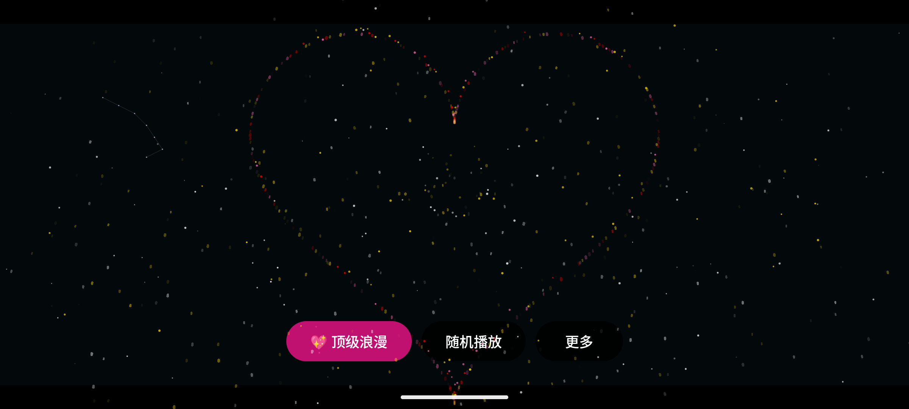
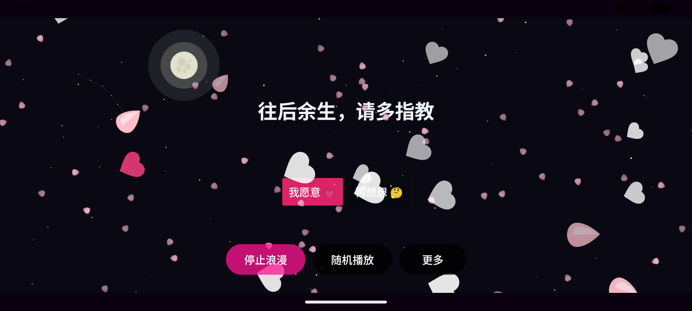
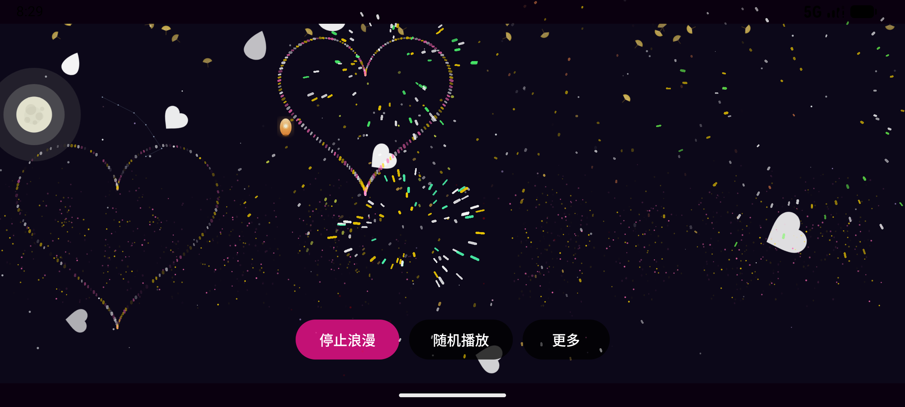

# 🎆 浪漫烟花 Romantic Fireworks

一个为你心里那个人做的 Android 烟花告白应用：夜空、烟花、三幕剧表白、应答时刻——从"这一刻，只为你说"到她按下"我愿意"。

基于开源烟花库 [fireworksandroid](https://github.com/xiaobo2001/fireworksandroid) 构建，支持动态壁纸、孔明灯、真实月相、天气粒子与音乐律动。

<p align="center">
  
  <br/>
  <em>主界面：星空 · 真实月相月亮 · 当日星座连线 · 时段氛围叠色</em>
</p>

## ✨ 核心玩法

| 玩法 | 说明 |
|---|---|
| 🔥 **点击屏幕** | 随机放一发烟花（10 种样式池：圆形 / 爱心 / 五角星 / 火箭 / 自定义文字 / 🌹玫瑰 / 💍戒指 / 💎钻石 / 金色雨 / 彩虹圈） |
| ⏳ **长按蓄力** | 按住 0.5s / 1s / 1.5s 分级点亮火花，松开放中 / 大 / 超大烟花（超大=中心巨型爱心+八向环射全屏） |
| 🌌 **夜空层** | 星空闪烁 + 随机流星 + 孔明灯 + 真实月相（8 个月相阶段）+ 月升月落 + 当日星座 + 雪/樱花/银杏雨 + 时段氛围色 |
| 💖 **顶级浪漫（三幕剧）** | 开场仪式 → 倒计时 → 多段台词（每句心跳震动 + TTS 朗读）→ 幕一爱心绽放 → 幕二花海流星雨 → 幕三同心圆终章 → **应答时刻** |
| 🎲 **应答时刻** | 屏幕浮现"我愿意 💗 / 再想想 🤔"——点"我愿意"触发 16 连发庆祝 + 金色银杏雨 + 自动生成**纪念卡片**；30 秒未选自动温柔收场 |
| 🏮 **孔明灯模式** | 点击放灯：暖色纸灯缓缓升空摇曳 |
| 🎵 **音乐律动** | 麦克风实时采集，烟花随音乐节拍编舞绽放（色相逐拍流转 / 强弱拍交替） |
| 📱 **摇一摇** | 摇动手机满屏连发烟花 |
| 🎄 **节日主题** | 春节（福字/红包）/ 生日（蛋糕/气球）/ 圣诞（圣诞树/雪）一键切换 |

<p align="center">
  
  
  <br/>
  <em>左：长按蓄力超大级（中心巨型爱心+八向环射）｜右：应答时刻</em>
</p>

<p align="center">
  
  <br/>
  <em>点下"我愿意"：16 连发庆祝 + 金色银杏雨</em>
</p>

## 📦 功能清单

**浪漫模式**
- 多段告白台词（最多 4 句依次演出，逐句 TTS 朗读 + 心跳震动 + 心脏搏动强调）
- 倒计时 1–60 秒可选（求婚长倒数），数字颜色递进（3 金 → 2 粉 → 1 红）
- BGM：内置浪漫曲或从手机选歌 + 音量调节 + 开场淡入 / 结尾淡出
- 同步录制整场视频（录到庆祝结束，3 分钟保护上限）
- 表白纪念卡片自动生成（日期 + 台词 + 当晚星座月相），保存到相册可微信直发
- 表白成功日自动记入纪念日列表
- 分享码 v2：多段台词 + 秒数 + 音量一码打包，对方导入即复刻（兼容 v1 旧码）
- 视频转 GIF：录好的 MP4 一键转 320px GIF 动图

**氛围系统**
- 动态壁纸：夜空 + 随机烟花（含图形烟花）+ 点击出烟花 + 双击放孔明灯
- 独立省电档：壁纸常驻时自动降帧率/粒子数
- 天气粒子：雪（柔光雪绒+六臂晶体双精灵三层景深）/ 樱花 / 银杏
- 月亮：按当天真实月相绘制（明暗界线全 8 阶段 + 月海纹理 + 地照），月升月落生命周期
- 星座：按真实日期显示当日星座连线

**交互与设置**
- 随机播放四剧本：经典 / 波浪扫射 / 环形聚拢 / 音乐节拍
- 指尖发射：点击 → 火箭从底部升起在指尖炸开
- 烟花余辉：粒子熄灭后留 1 秒薄纱残影
- 纯净模式：隐藏按钮栏沉浸观景
- 桌面小组件："💖 一键浪漫"直达
- 更多菜单四组分区（场景氛围 / 烟花与播放 / 记录与分享 / 其他）+ 开关状态点

## 🚀 快速开始

```bash
git clone https://github.com/xiaobo2001/electronic.git
```

用 **Android Studio** 打开项目，等 Gradle 同步完成，连上手机/模拟器点 Run 即可。

- 最低支持 Android 7.0（API 24），目标 SDK 35
- 麦克风权限仅用于音乐律动（可拒绝，其余功能不受影响）
- 首次进入有玩法速览引导，更多菜单里可随时重看

### 主要依赖

| 依赖 | 用途 |
|---|---|
| [fireworksandroid](https://github.com/xiaobo2001/fireworksandroid) v1.3.1 | 烟花 / 夜空 / 音乐律动核心库（同作者开源） |
| [MMKV](https://github.com/Tencent/MMKV) | 本地设置存储 |
| [Balloon](https://github.com/skydoves/Balloon) | 更多菜单弹层 |

## 🎬 推荐表白流程

1. 更多菜单 → 选好节日主题 / 天气 / BGM（从手机选她喜欢的歌）
2. 顶级浪漫 → 输入多段台词（如"从遇见你的那天起 → 往后余生，请多指教"）→ 勾选"同步录制整场"
3. 把手机递给她 → 开场仪式、倒计时、三幕剧依次上演
4. 应答时刻她点"我愿意" → 终极庆祝 + 纪念卡片自动落盘
5. 生成视频/GIF 直接发朋友圈

## 🗂 项目结构

```
app/src/main/java/com/xiaobo/electronic/
├── MainActivity.java          # 主界面 + 触摸/蓄力/浪漫三幕剧调度
├── FireworkWallpaperService.java  # 动态壁纸服务
├── ScreenRecorderService.java  # 录屏前台服务（MP4）
├── ParticleTextView.java      # 粒子文字（倒计时/台词）
├── MementoCard.java            # 表白纪念卡片生成
├── GifExporter.java            # MP4→GIF 编码器（纯 Java）
├── ThemeManager.java           # 节日主题包
├── ShakeDetector.java          # 摇一摇传感器
├── RomanticWidgetProvider.java # 桌面小组件
├── RomanticShareCodec.java     # 分享码 v1/v2 编解码
├── DevicePerf.java             # 设备档位调度
└── StartupTracer.java          # 启动性能追踪（logcat）
```

## 🧪 测试与 CI

- 单元测试：`RomanticShareCodecTest`（分享码/台词切分）、库内 `SkyAlgorithmTest`（星座/月相算法）
- GitHub Actions：push 自动跑单测 + 构建（debug APK / release AAR）

## 📄 隐私说明

所有设置、台词、纪念日均存储在本机 MMKV，无任何网络上传。麦克风仅用于音乐律动的本地振幅分析，不做录音存储。

## 🔗 相关仓库

- 烟花库：[xiaobo2001/fireworksandroid](https://github.com/xiaobo2001/fireworksandroid) —— 本应用的核心特效引擎，独立可用，欢迎 Star
